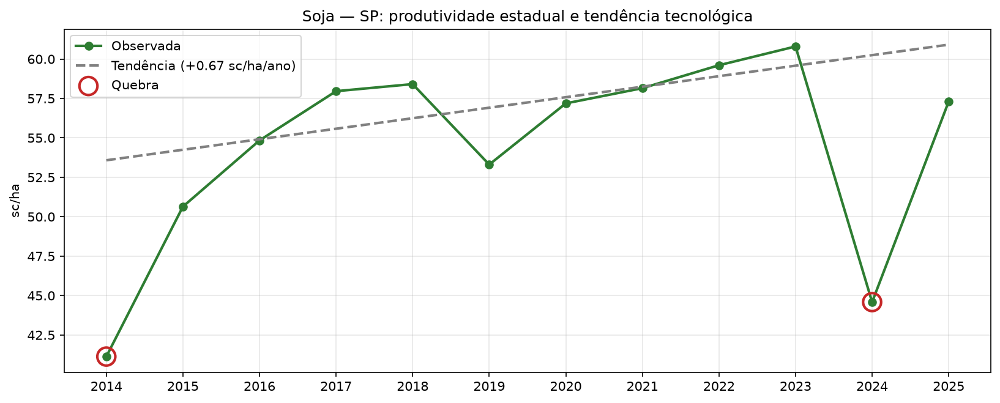
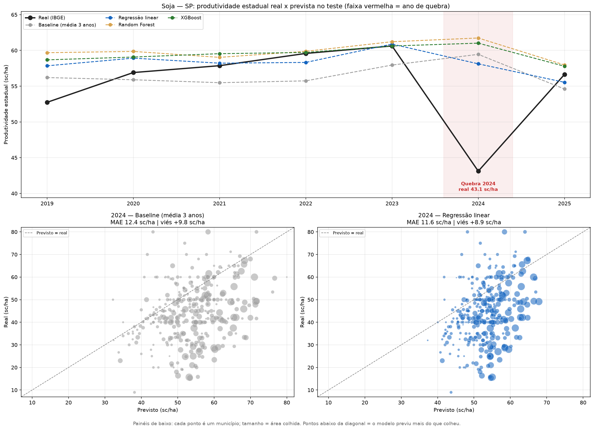
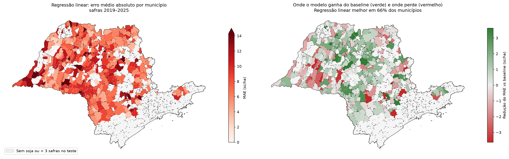
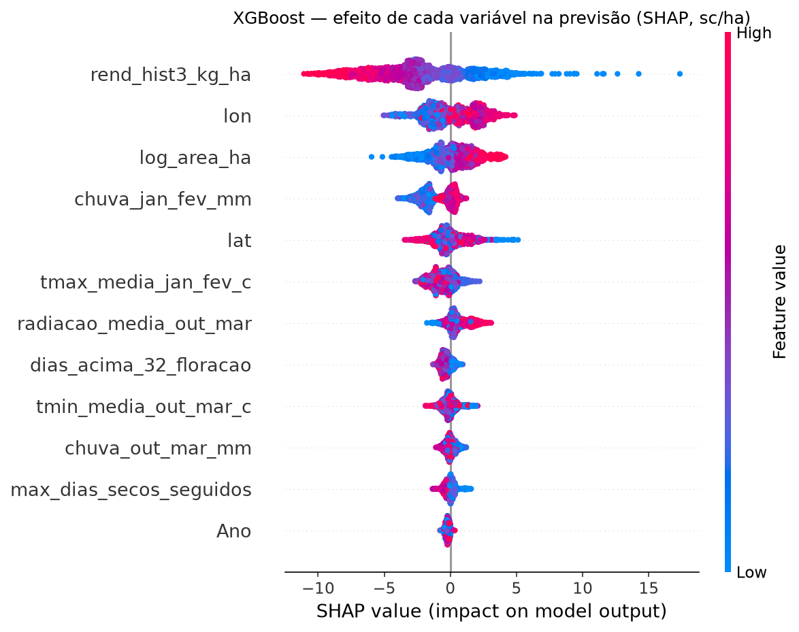

# A safra antes da colheita: dá para prever a produtividade da soja só com dados públicos?

Previsão da produtividade de soja (sc/ha) por município de São Paulo usando apenas dados abertos:
**IBGE/PAM** (produção municipal), **Conab** (validação) e **NASA POWER** (clima diário).

> **Resposta curta:** **Muito pouco.** O Regressão linear reduziu o erro médio de 8.1 para 7.7 sc/ha (apenas 4%). O clima público agrega, mas pouco além do histórico do município.

---

## Ato 1 — O cenário: SP produz cada vez mais, mas não todo ano

- 514 municípios colheram soja entre 2014 e 2025; a área colhida passou de
  693 mil ha para 1,376 mil ha.
- Ganho tecnológico (tendência Theil-Sen, robusta a anos ruins): **+0.67 sc/ha por ano**
  (+1.2% a.a.).
- Anos de quebra (≥ 10% abaixo da tendência): **2014 (-23%), 2024 (-26%)**.



## Ato 2 — O risco: onde e quando a produtividade oscila

- Coeficiente de variação por município (sem a tendência tecnológica), em 330 municípios com série
  longa e confiável. CV mediano: **18.1%**.
- Quadrantes produtividade x estabilidade: Baixa e arriscada: 102, Alta e estável: 102, Alta e arriscada: 63, Baixa e estável: 63 municípios.
  Os "alta e estável" concentram **49% da área**.
- Anos ruins são **generalizados**, não localizados: em 2024, 82% dos
  municípios ficaram abaixo do próprio normal. Anos atípicos ruins: [2014, 2024]; bons: [2017, 2018].
- Cuidado de qualidade: séries da PAM com o mesmo valor repetido ano após ano foram marcadas como
  suspeitas (parecem estáveis, mas é falta de informação) e ficaram fora do modelo.

## Ato 3 — Os dados merecem confiança? E o clima explica alguma coisa?

- **IBGE x Conab:** diferença absoluta média de 4.2% na produtividade estadual e correlação de
  **0.95** nos desvios da tendência. As duas fontes enxergam os mesmos anos ruins.
- **Clima (NASA POWER, out–mar):** chuva, temperatura, calor na floração, veranico e radiação para cada
  município e safra. A anomalia que mais se associa à queda é `tmax_media_jan_fev_c` (Spearman -0.34)
  e a que mais se associa a ganho é `chuva_jan_fev_mm` (+0.27).

## Ato 4 — A base de modelagem, sem vazamento

- Uma linha por município x safra: **3,170 linhas, 378 municípios,
  safras 2016–2025**, 12 variáveis.
- Só entra o que se sabe **antes do resultado oficial**: média dos 3 anos anteriores, área do ano anterior,
  localização e clima da safra. Um teste refaz o histórico "na mão" em 200 linhas sorteadas para
  garantir que nenhum dado do próprio ano vaza.

## Ato 5 — Os modelos

**Validação temporal:** treino com safras até 2018, teste de 2019 a 2025
(2,403 municípios-safra). Nada de divisão aleatória.
**Baseline:** média dos 3 anos anteriores do município, o número a bater.

**O que os modelos preveem:** não a produtividade bruta, mas a **correção sobre o baseline**
(rendimento do ano − média dos 3 anos anteriores). A previsão final é baseline + correção. Assim o nível de
cada município e a tendência tecnológica vêm do histórico, e os modelos se concentram no que muda de um ano
para o outro, que é onde o clima deveria aparecer. O **R² da correção** mede exatamente essa parte: 0 = não
explica nada além do baseline, 1 = explica toda a variação do ano.

| Modelo | MAE (sc/ha) | RMSE (sc/ha) | R² | R² da correção | MAE anos de quebra | Ganho MAE vs baseline (%) | Ganho MAE anos de quebra vs baseline (%) |
|---|---|---|---|---|---|---|---|
| Baseline (média 3 anos) | 8.06 | 11.10 | 0.08 | -0.00 | 12.37 | +0% | +0% |
| Regressão linear | 7.72 | 10.32 | 0.21 | 0.14 | 11.59 | +4% | +6% |
| Random Forest | 8.23 | 11.12 | 0.08 | -0.00 | 14.09 | -2% | -14% |
| XGBoost | 8.08 | 10.85 | 0.13 | 0.05 | 13.25 | -0% | -7% |

Nos anos de quebra do teste (2024) o Regressão linear errou 6% **menos** que o baseline, e nos anos normais ganhou 4%.



**Onde o modelo erra:** o Regressão linear é melhor que o baseline em 66% dos municípios.



**O que o XGBoost aprendeu (SHAP)** — quanto cada variável fez o modelo corrigir a média dos 3 anos:

| Variável | Peso médio na correção (sc/ha) | Direção |
|---|---|---|
| `rend_hist3_kg_ha` | 3.58 | ↓ valor alto corrige para baixo |
| `lon` | 1.53 | ↑ valor alto corrige para cima |
| `log_area_ha` | 1.28 | ↑ valor alto corrige para cima |
| `chuva_jan_fev_mm` | 1.21 | ↑ valor alto corrige para cima |
| `lat` | 0.86 | não monotônica / fraca |



---

## Limitações (e o que eu faria a seguir)

- **Pouco treino:** exigir 3 anos de histórico faz a base começar em 2016, e o treino fica com
  3 safras, todas normais ou boas. Variáveis com valores no teste fora do que o treino viu:
  `chuva_out_mar_mm` (29%), `chuva_jan_fev_mm` (42%), `dias_acima_32_floracao` (30%), `tmax_media_jan_fev_c` (30%), `tmin_media_out_mar_c` (4%), `radiacao_media_out_mar` (24%). Árvores não extrapolam, então um calor inédito é tratado como o maior calor já visto.
- **Baseline atrasado:** a média dos 3 anos anteriores fica, em média, ~2 safras atrás da tendência tecnológica,
  então tende a subestimar. Prever a correção (em vez do rendimento bruto) evita que as árvores tenham que
  extrapolar o `Ano`, mas o modelo só aprende o tamanho desse atraso pelo que viu no treino. Próximo passo:
  usar como base a tendência ajustada de cada município.
- **Clima no centroide do município**, não na lavoura. Próximo passo: ponderar o clima pela máscara de soja
  (MapBiomas).
- **Dado oficial com ruído:** a PAM tem estimativas repetidas e arredondadas em municípios pequenos.
- **SHAP mostra associação, não causa.**
- Próximos passos: validação walk-forward como padrão, previsão antecipada (só com o clima até dezembro ou
  janeiro) e intervalos de previsão (regressão quantílica).

## Como reproduzir

```bash
pip install sidrapy geobr geopandas pandas numpy scipy matplotlib requests scikit-learn xgboost shap
jupyter notebook projeto_soja.ipynb
```

Fontes: [IBGE/SIDRA tabela 5457](https://sidra.ibge.gov.br/tabela/5457) ·
[Conab, série histórica de grãos](https://portaldeinformacoes.conab.gov.br/) ·
[NASA POWER](https://power.larc.nasa.gov/)
